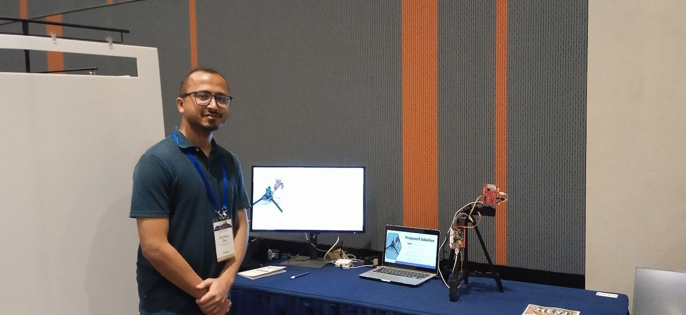
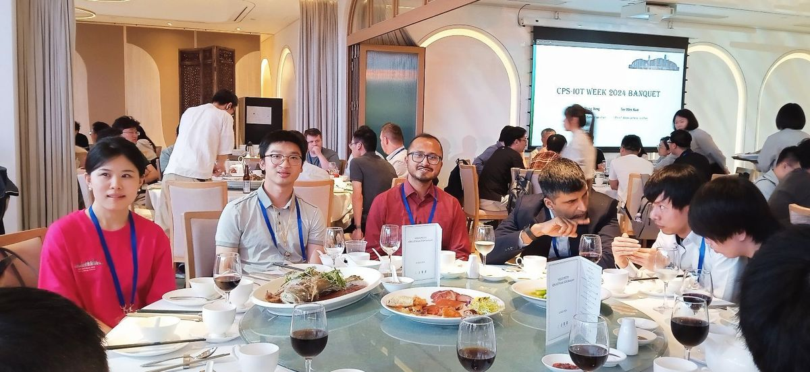
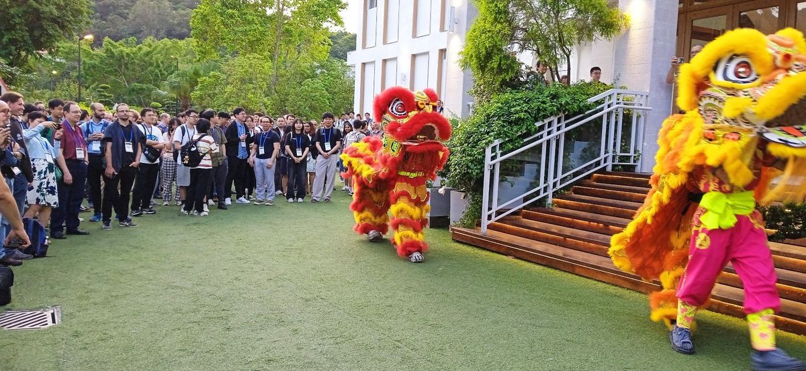
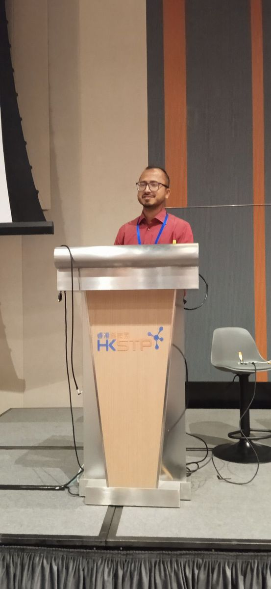

## 2024: IPSN in Hong Kong

I attended **CPS-IoT Week** in Hong Kong, where I presented our paper **MARS** at **ACM/IEEE IPSN 2024** and showcased it in a **live demo**, talking with researchers, academics and industry professionals from around the world. The feedback and conversations gave us new directions for future research.

If you missed the presentation, here is a [teaser of the paper](https://lnkd.in/dBr6r7RR).

  
  
  
  

If you're at a future conference, feel free to say hi. I'm always happy to discuss our work and explore collaborations.
