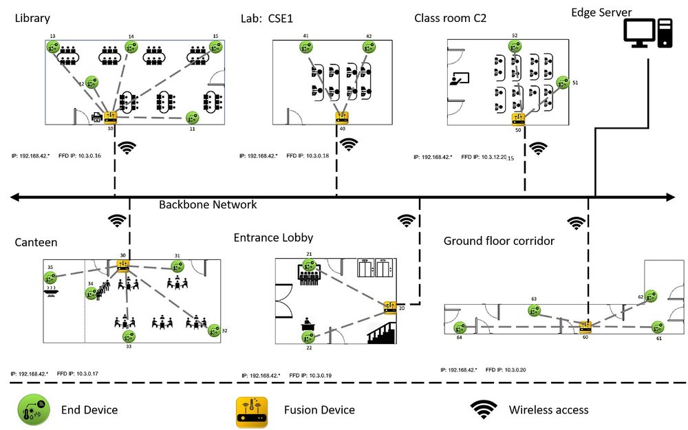
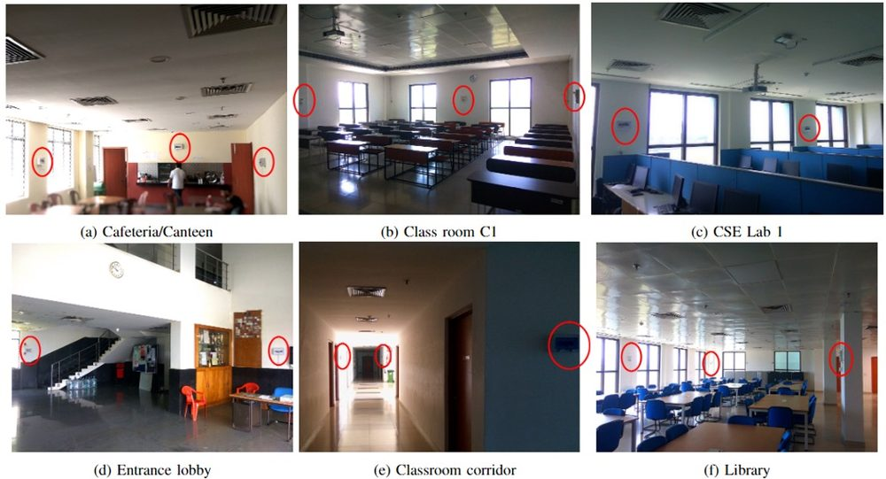
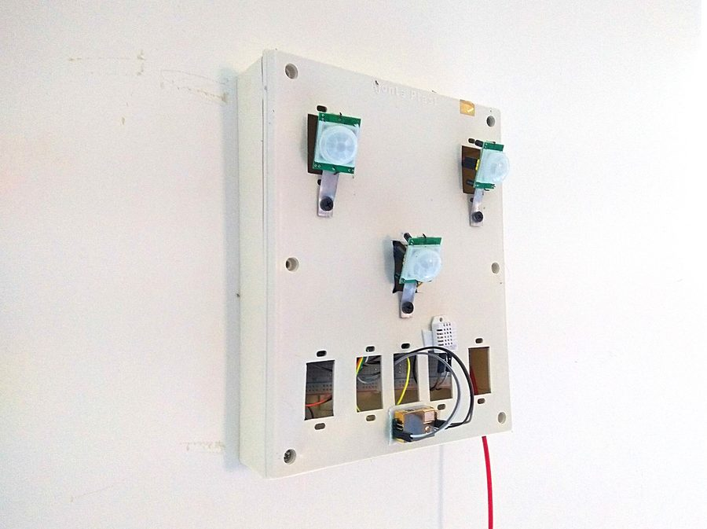

With the widespread adoption of IoT infrastructure, multiple smart applications and their services increasingly share one sensing platform. Shared infrastructure cuts installation and maintenance cost, and it also enables fast cross-domain inference: the same room-temperature and CO₂ readings can feed occupancy estimation for HVAC, surveillance and smart resource management at once.

Faster decisions need sensory data to be pre-processed at the network edge, but simulation platforms do not capture the real-world dynamics that affect edge-based sensing on shared infrastructure. We therefore built a testbed to evaluate such solutions for ambient living. It supports adaptive sensing and edge processing, aiming to reduce computation, communication and storage overhead in continuous automated monitoring while keeping stakeholder applications performing well. Diverse sensing nodes are deployed across the academic building, and the design accommodates multiple applications with different QoS requirements on one shared sensing infrastructure.

<figure><figcaption>Deployment map</figcaption></figure>
<figure><figcaption>Nodes deployed at various locations</figcaption></figure>
<figure class="figure--narrow"><figcaption>A sensing node</figcaption></figure>

Details: [*Experience: Developing a Testbed for Ambient Sensing and in-Network Data Processing*](https://doi.org/10.1109/COMSNETS53615.2022.9668593), COMSNETS 2022.
